# Fleet discount use cases

Ten use cases for [TICKET-142](../TICKET-142.md), written so that someone from the business can read them and check them against the real app. Each one gives the scenario from the specs, the steps, what the app showed and what that proves.

The screens are real output from version 2.7 on a copy of the sample data, and [README.md](README.md) explains how they were captured. The yellow highlight is added to show where to look, and the text is unchanged.

| Use case | Outcome |
|---|---|
| [UC-01: Mark an existing customer as fleet](#uc-01-mark-an-existing-customer-as-fleet) | Greenway Taxis shows as Fleet, and stays Fleet after a restart |
| [UC-02: Return a fleet customer to retail](#uc-02-return-a-fleet-customer-to-retail) | The customer file goes back to exactly what it was |
| [UC-03: Add a new fleet customer](#uc-03-add-a-new-fleet-customer) | Saved as Fleet, and a trade customer is never asked |
| [UC-04: A customer who cannot be marked](#uc-04-a-customer-who-cannot-be-marked) | Trade and unknown customers are refused, and nothing is saved |
| [UC-05: Quote a fleet customer](#uc-05-quote-a-fleet-customer) | 4% off the list price on its own line, with fees untouched |
| [UC-06: Sell to a fleet customer](#uc-06-sell-to-a-fleet-customer) | The invoice keeps its fleet line after a restart |
| [UC-07: Customers who are not fleet](#uc-07-customers-who-are-not-fleet) | Nothing changes, to the penny |
| [UC-08: Existing invoices and data files](#uc-08-existing-invoices-and-data-files) | They load as they are and read the same |
| [UC-09: A fleet customer with no email](#uc-09-a-fleet-customer-with-no-email) | Stays Fleet after a restart |
| [UC-10: Roll back to v2.6 and return](#uc-10-roll-back-to-v26-and-return) | Amounts stay correct, with two costs shown |

The last section shows [the tests behind these use cases](#the-tests-behind-these-use-cases), including what happens when the discount rate is wrong.

## UC-01: Mark an existing customer as fleet

**Who:** sales staff. **Starts with:** Greenway Taxis (2008) is a Retail customer. **Ticket:** "existing ones like Greenway Taxis".

```text
GIVEN the sample showroom data
WHEN  staff mark customer 2008 as a fleet customer
THEN  the system shows "Customer 2008 is now a fleet customer."
AND   the customer is saved as type F
```

```text
  Main menu           Customers menu                       Fleet Customer screen
  2. Customers  --->  4. Mark / unmark fleet customer ---> Customer ID : 2008
                                                                  |
                                                                  v
                                                     type R becomes F, saved now
```

**1. Before the change, Greenway Taxis is Retail.**

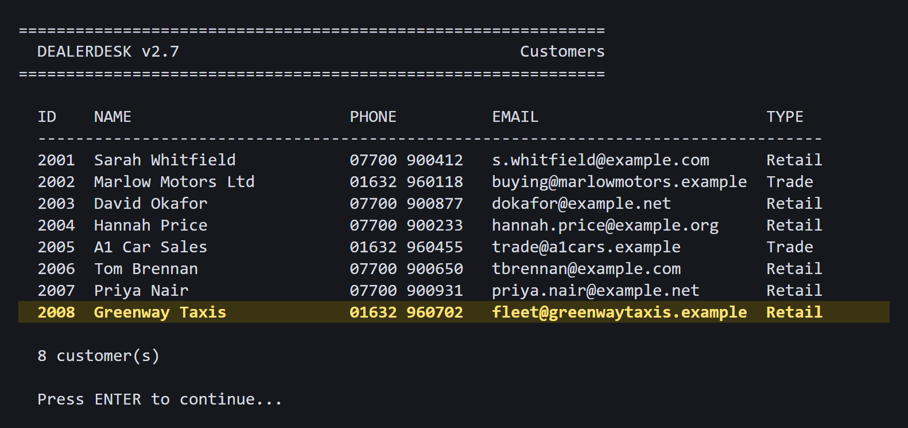

**2. Staff choose option 4 on the Customers menu.**

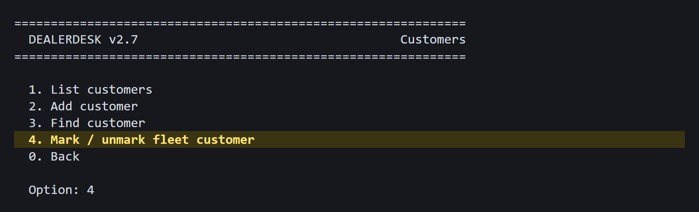

**3. Staff enter the customer id, and the app confirms straight away.**

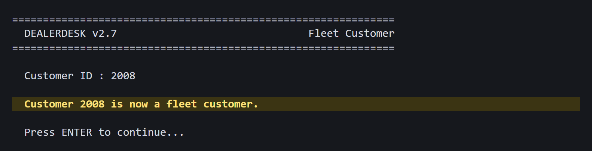

**4. After a restart of the app, Greenway Taxis shows as Fleet.**

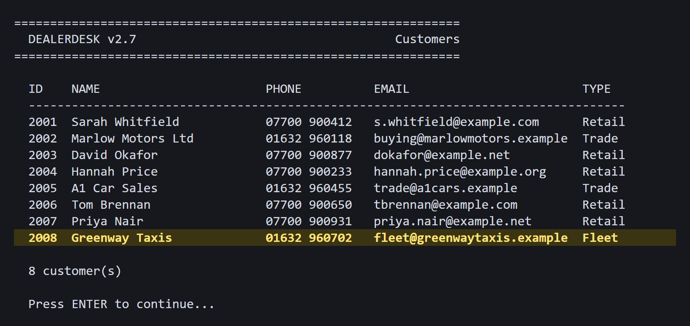

**In the data file**, the only change is the last letter of that one record:

```console
$ grep '^2008' data/customers.dat
2008|Greenway Taxis|01632 960702|fleet@greenwaytaxis.example|R
$ grep '^2008' data/customers.dat
2008|Greenway Taxis|01632 960702|fleet@greenwaytaxis.example|F
```

**This proves** that an existing customer can be marked without retyping anything, and that the change is saved the moment it is made.

**Tested by:** `Retail customer marked as fleet`, `Fleet status after a restart`, `Fleet customer in the list`, `Marking a customer changes only that record`.

## UC-02: Return a fleet customer to retail

**Who:** sales staff. **Starts with:** a customer was marked by mistake, or their fleet deal has ended.

```text
GIVEN Greenway Taxis (2008) marked as a fleet customer
WHEN  staff choose to mark customer 2008 again
THEN  the system shows "Customer 2008 is no longer a fleet customer."
AND   the customer is saved as type R
```

```text
  F  Fleet  --- Customers > 4, enter 2008 again --->  R  Retail
```


**In the data file**, marking and unmarking leaves the file exactly as it started:

```console
$ grep '^2008' data/customers.dat
2008|Greenway Taxis|01632 960702|fleet@greenwaytaxis.example|R
$ cmp data/customers.dat original/customers.dat && echo 'customers.dat matches the sample data again'
customers.dat matches the sample data again
```

**This proves** that a mistake can be undone. The ticket does not ask for this, but the app has no screen for editing a customer, so without it a wrong mark could never be corrected. It only changes the customer: invoices already issued stay as they are, as UC-08 shows.

**Tested by:** `Fleet customer returned to retail`, `Fleet status removed before a sale`, `Fleet invoice after fleet status is removed`.

## UC-03: Add a new fleet customer

**Who:** sales staff. **Starts with:** a new business signs a fleet deal. **Ticket:** "both when adding a new customer".

```text
GIVEN the sample showroom data
WHEN  staff add a customer, answer N to the trade question and Y to the fleet question
THEN  the customer is saved as type F with the next customer id
```

```text
  Trade customer (Y/N)?
     |            |
     Y            N or ENTER
     |            |
     v            v
   Trade     Fleet customer (Y/N)?
                |            |
                Y            N or ENTER
                |            |
                v            v
              Fleet        Retail
```

**1. Staff answer N to the trade question and Y to the fleet question.**

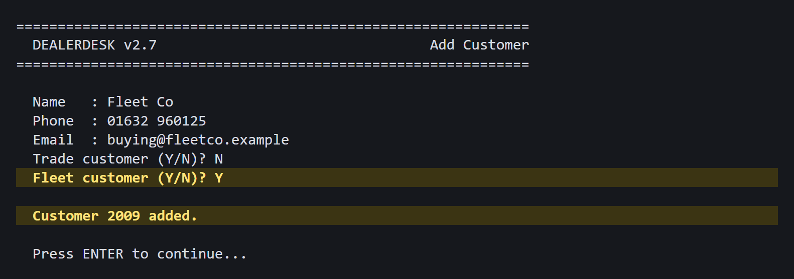

**2. After a restart, the new customer shows as Fleet.**

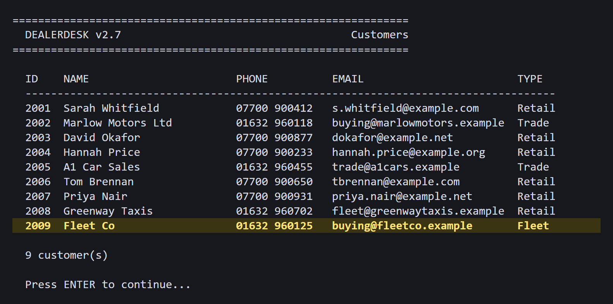

```console
$ grep '^2009' data/customers.dat
2009|Fleet Co|01632 960125|buying@fleetco.example|F
```

**Another path: a trade customer is never asked.** After a Y to the trade question the fleet question does not appear, so a customer cannot be both.

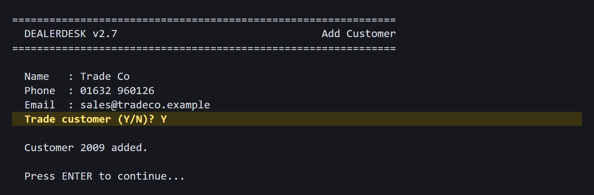

**This proves** that a fleet customer can be added in one go, and that staff adding a trade customer see nothing new. Pressing ENTER at the fleet question means no, so a retail customer is one keypress away from the old flow.

**Tested by:** `Fleet customer added`, `Trade customer is not asked the fleet question`, `Blank answer to the fleet question`, `Retail customer added`.

## UC-04: A customer who cannot be marked

**Who:** sales staff. **Starts with:** staff type the id of a trade customer, or an id that does not exist.

```text
GIVEN the sample showroom data
WHEN  staff mark customer 2002, a trade customer, as a fleet customer
THEN  the system shows "Trade customers cannot be fleet customers."
AND   the data files are unchanged
```

```text
  Customer ID : ____
       |
       +--- type T ----> refused, stays Trade
       |
       +--- no match --> "Customer not found."
```

**1. A trade customer is refused.** Allowing it would cut their discount from 10% to 4% on one wrong keystroke.

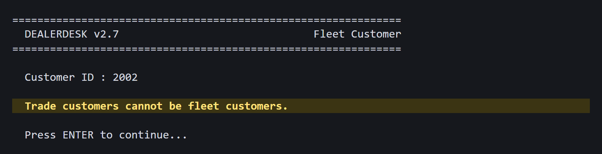

**2. An unknown id is refused.**

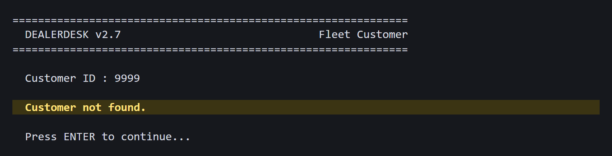

```console
$ cmp data/customers.dat original/customers.dat && echo 'customers.dat is unchanged'
customers.dat is unchanged
```

**This proves** that a mistake here cannot change anyone's discount. The ticket does not mention this case, so it was a product decision, explained in [fleet-discount.md](../fleet-discount.md).

**Tested by:** `Trade customer refused`, `Marking an unknown customer`.

## UC-05: Quote a fleet customer

**Who:** sales staff. **Starts with:** Greenway Taxis is marked as fleet. **Ticket:** "4% off the vehicle price", "its own line", and the acceptance criterion for a "Fleet discount" line and the correct total.

```text
GIVEN Greenway Taxis (2008) marked as a fleet customer
WHEN  staff quote vehicle 1002, listed at 10995.00, for customer 2008 with no discount and no trade-in
THEN  the fleet discount is -439.80, net is 10555.20, VAT is 2141.04 and the total is 12901.24
```

```text
  3. Quote ---> Vehicle ID, Customer ID, Discount %, Trade-in
                       |
                       v
         type F: 4% of the list price, on its own line
                       |
                       v
         Quote on screen. Nothing is saved.
```

**1. No other discount.** The discount has its own line, and delivery and the registration fee are still 150.00 and 55.00.

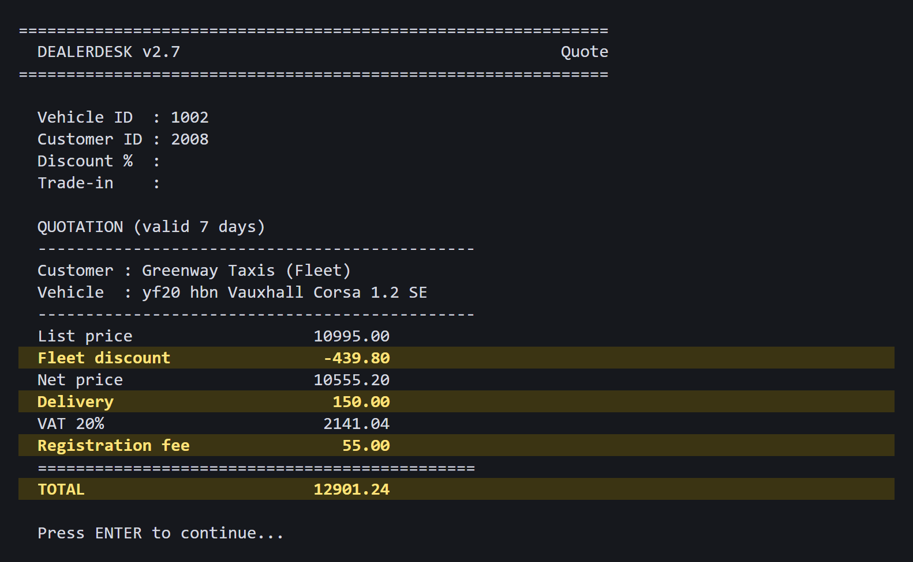

**2. Every deduction together.** The salesman discount applies after the fleet discount: 5% of 12240.00 is 612.00. The [priced diagram](diagrams.md#how-a-quote-is-priced) walks through this quote line by line.

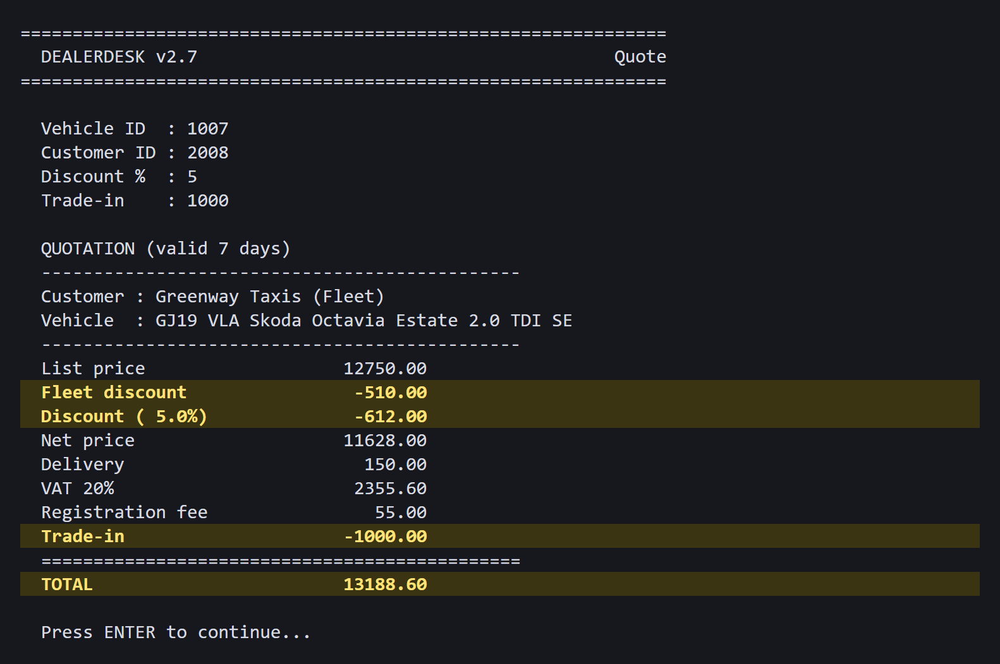

**3. The salesman limit is untouched.** Staff type 20%, and the existing limit reduces it to 15%. The fleet discount is on top of that limit, so it does not use up what the salesperson has left to negotiate with, which was the complaint in the ticket.

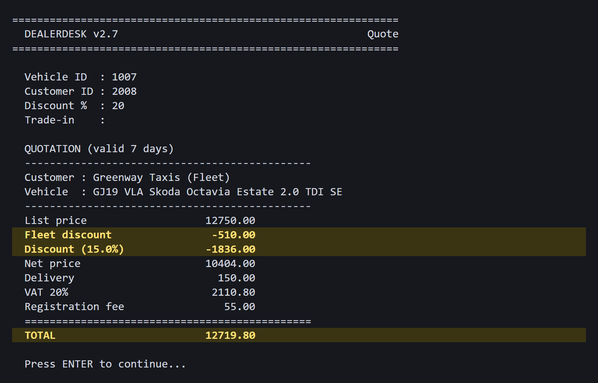

| Vehicle and list price | Salesman | Trade-in | Fleet | Net | VAT | Total |
|---|---|---|---|---|---|---|
| 1002, 10995.00 | none | none | -439.80 | 10555.20 | 2141.04 | 12901.24 |
| 1007, 12750.00 | 5% | 1000.00 | -510.00 | 11628.00 | 2355.60 | 13188.60 |
| 1007, 12750.00 | 20%, limited to 15% | none | -510.00 | 10404.00 | 2110.80 | 12719.80 |

**This proves** that the discount is automatic, is 4% of the vehicle price only, and shows on its own line. Each total was worked out again separately from the pricing rules, and all three match to the penny.

**Tested by:** `Fleet customer with no other discount`, `Fleet customer on another vehicle`, `Fleet customer with a discount and a trade-in`, `Fees are not discounted for a fleet customer`, `Fleet discount rounds to the penny`, `Fleet quote heading`, `Fleet discount line`, `Discount after fleet discount`, `Fleet discount does not use up the salesman limit`.

## UC-06: Sell to a fleet customer

**Who:** sales staff. **Starts with:** Greenway Taxis is marked as fleet. **Ticket:** "its own line on quotes and invoices".

```text
GIVEN Greenway Taxis (2008) marked as a fleet customer
WHEN  staff sell vehicle 1002 to customer 2008 with no discount and no trade-in
THEN  the invoice stores list 10995.00, discount 439.80, net 10555.20, VAT 2141.04, fees 205.00, total 12901.24 and fleet discount 439.80
```

```text
  4. Sell vehicle ---> same questions as a quote ---> INVOICE PREVIEW ---> Confirm sale (Y/N)?
                                                                                  |
                                                                                  Y
                                                                                  |
                                                                                  v
                                                       invoices.dat gets the invoice
                                                       stock.dat marks the vehicle sold
```

**1. The preview uses the same pricing as the quote, and staff confirm.**

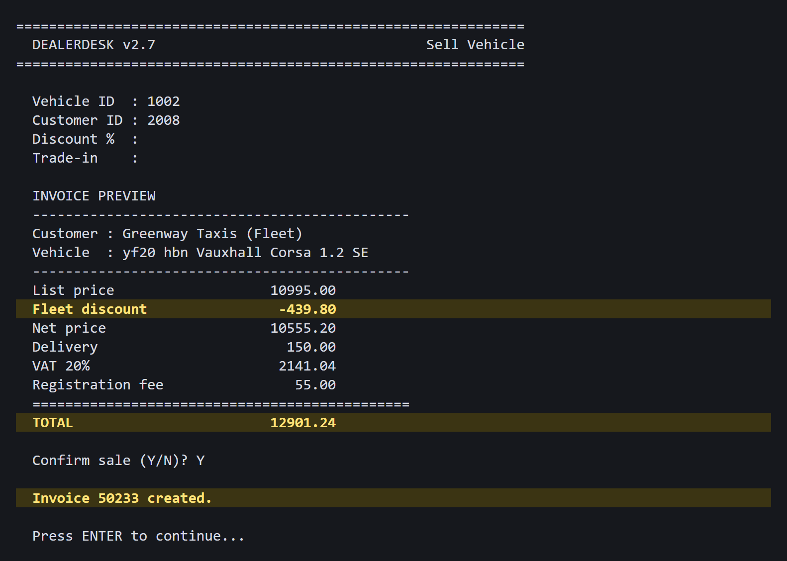

**2. After a restart, the invoice shows the fleet discount on its own line.** With no other discount there is no discounts line, because it would only print -0.00.

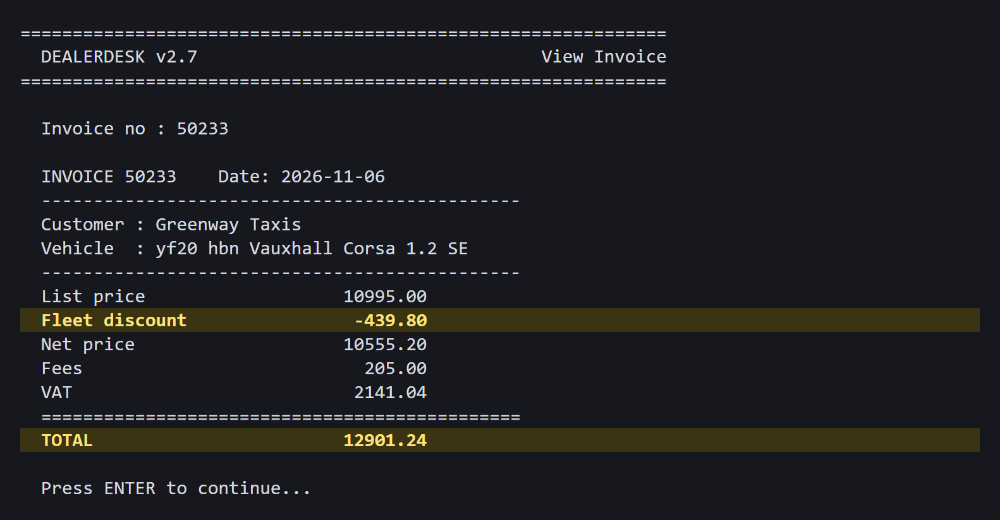

**3. A second sale with every deduction shows each one separately.**

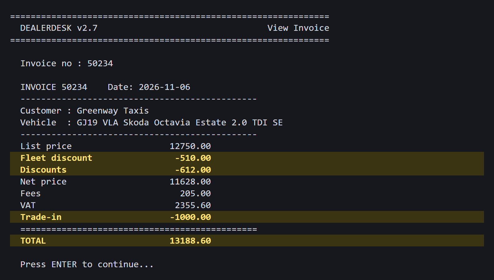

**In the data file**, a fleet invoice has a twelfth field holding the fleet amount, and the sixth field still holds every discount added together (510.00 + 612.00 = 1122.00). Older invoices keep their eleven fields.

```console
$ grep -E '^5023[34]' data/invoices.dat
50233|2026-11-06|1002|2008|10995.00|439.80|10555.20|2141.04|205.00|0.00|12901.24|439.80
50234|2026-11-06|1007|2008|12750.00|1122.00|11628.00|2355.60|205.00|1000.00|13188.60|510.00
$ awk -F'|' '{ print $1, NF, "fields" }' data/invoices.dat
50230 11 fields
50231 11 fields
50232 11 fields
50233 12 fields
50234 12 fields
```

**This proves** that the amounts on the quote are the amounts on the invoice, and that the fleet line comes from what was stored, not from the customer's type today.

**Tested by:** `Invoice preview for a fleet customer`, `Fleet sale amounts`, `Fleet sale with every deduction`, `Fleet invoice with no other discount`, `Fleet invoice with another discount`, `Invoice with a fleet discount has twelve fields`, `New fleet customer buys a vehicle`, `Greenway becomes a fleet customer`.

## UC-07: Customers who are not fleet

**Who:** every other customer. **Ticket:** "Quotes and invoices for non-fleet customers are unchanged, to the penny".

```text
GIVEN the sample showroom data
WHEN  staff quote vehicle 1002 for customer 2001
THEN  the quote has no fleet discount line and the total is 13429.00
```

The same keystrokes were played on real v2.6 and real v2.7: a retail quote, two trade quotes, a sale and an invoice.

```text
  Same keystrokes ---> v2.6 ---> screens and data files ---+
                                                           +---> compare them
  Same keystrokes ---> v2.7 ---> screens and data files ---+
```

**1. A retail quote has no fleet line.**

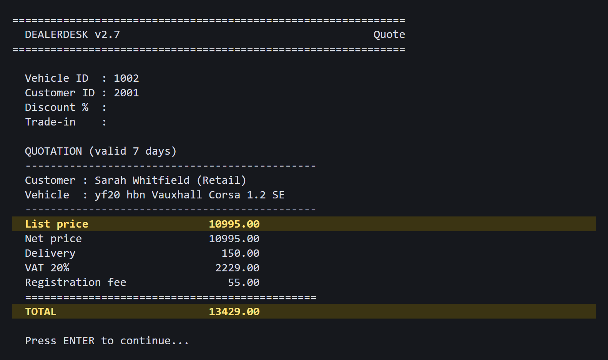

**2. A trade quote keeps its trade discount and has no fleet line.**

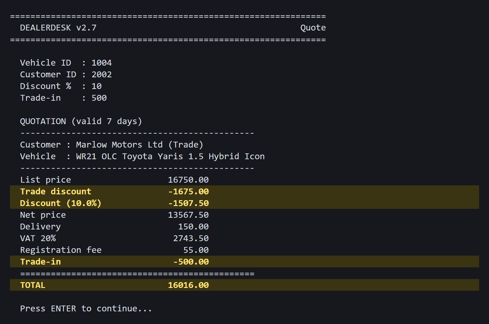

**3. The comparison.** The session has 13 screens. The 26 lines that differ are the version in those 13 headers, in each of the two sessions. No other line differs, and all four data files are identical.

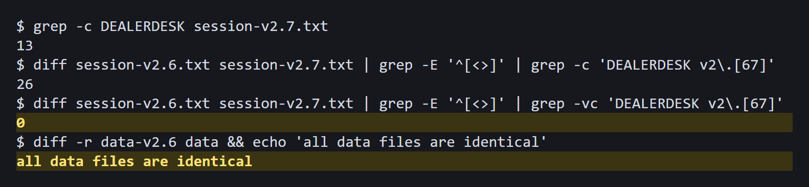

**Can this comparison fail?** Yes. Marking Sarah Whitfield as fleet first and replaying the same keystrokes shows the difference straight away. These are the first lines:

```console
$ diff session-v2.6.txt session-control.txt | grep -E '^[<>]' | grep -v 'DEALERDESK v2\.[67]'
<   Customer : Sarah Whitfield (Retail)
>   Customer : Sarah Whitfield (Fleet)
<   Net price                    10995.00
>   Fleet discount                -439.80
>   Net price                    10555.20
<   VAT 20%                       2229.00
>   VAT 20%                       2141.04
<   TOTAL                        13429.00
>   TOTAL                        12901.24
```

**This proves** the ticket's "unchanged, to the penny" for this session. The wider proof is the test baselines: of the six recorded sessions, five were not re-recorded for v2.7, and the sixth changed only for the new menu option and the new prompt.

**Tested by:** `Retail customer gets no fleet discount`, `Trade customer gets no fleet discount`, `Invoice with no fleet discount keeps eleven fields`, `Fleet status removed before a sale`.

## UC-08: Existing invoices and data files

**Who:** the business, for its records. **Ticket:** "Existing data files load without any manual conversion" and "Existing invoices still display correctly".

```text
GIVEN Greenway Taxis (2008) marked as a fleet customer
WHEN  staff view invoice 50232, issued before they became fleet
THEN  it shows list 10495.00, discounts -839.60, net 9655.40 and total 11821.48
AND   there is no fleet discount line
```

```text
  Invoice 50232 on screen ---> mark Greenway as fleet ---> Invoice 50232 on screen
          (A)                                                      (B)
                                                                    |
                                  sell Greenway a vehicle  <--------+
                                             |
                                             v
                         the three old invoice rows are still the same
```

Invoice 50232 is the problem the ticket describes. Greenway Taxis were given 8% by hand in 2021: 839.60 of 10495.00. It was issued that way, so it stays that way.

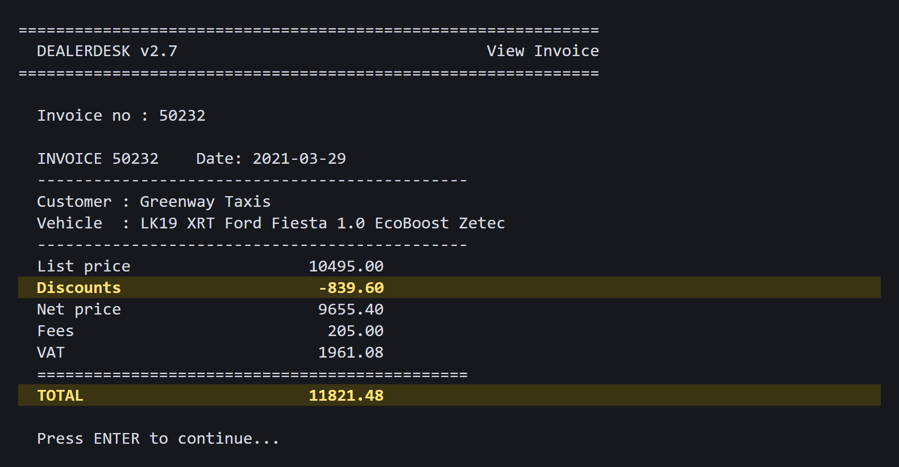

The sample files come from earlier versions, and no step converts them:

```console
$ cmp invoice-before.txt invoice-after.txt && echo 'invoice 50232 reads the same before and after'
invoice 50232 reads the same before and after
$ head -3 data/invoices.dat | cmp - original/invoices.dat && echo 'invoices 50230, 50231 and 50232 are byte-identical'
invoices 50230, 50231 and 50232 are byte-identical
$ awk -F'|' '{ print $1, NF, "fields" }' data/invoices.dat
50230 11 fields
50231 11 fields
50232 11 fields
50233 12 fields
```

**This proves** that an invoice is a record of what happened, and changing a customer's status does not rewrite history. Saving a new fleet invoice rewrites the whole file, and the old rows still come out byte for byte.

**Tested by:** `Earlier invoice after a customer becomes fleet`, `Fleet invoice after fleet status is removed`, `Invoice from an earlier version`, `Earlier invoices are unchanged by a fleet sale`.

## UC-09: A fleet customer with no email

**Who:** sales staff. **Starts with:** a fleet customer is added with their email left blank.

```text
GIVEN a fleet customer added with no email
WHEN  the app is restarted and staff quote vehicle 1002 for them
THEN  the customer shows as Fleet
AND   the fleet discount is -439.80 and the total is 12901.24
```

```text
  2009|No Email Fleet|01632 960123||F
                                  ||
                                  the blank email stays an empty field

  Before v2.7, the reader skipped empty fields, so the F landed in the email
  column and the type fell back to Retail. That is BUG-002.
```

```console
$ grep '^2009' data/customers.dat
2009|No Email Fleet|01632 960123||F
```

**1. After a restart, the email column is blank and the customer is still Fleet.**

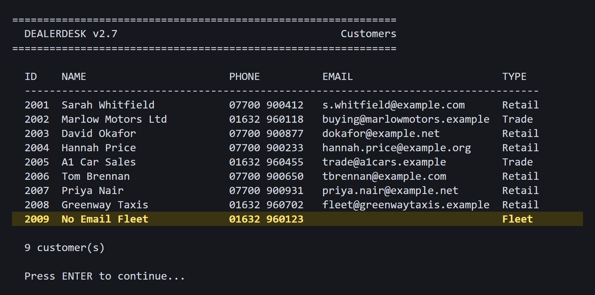

**2. The discount still applies.**

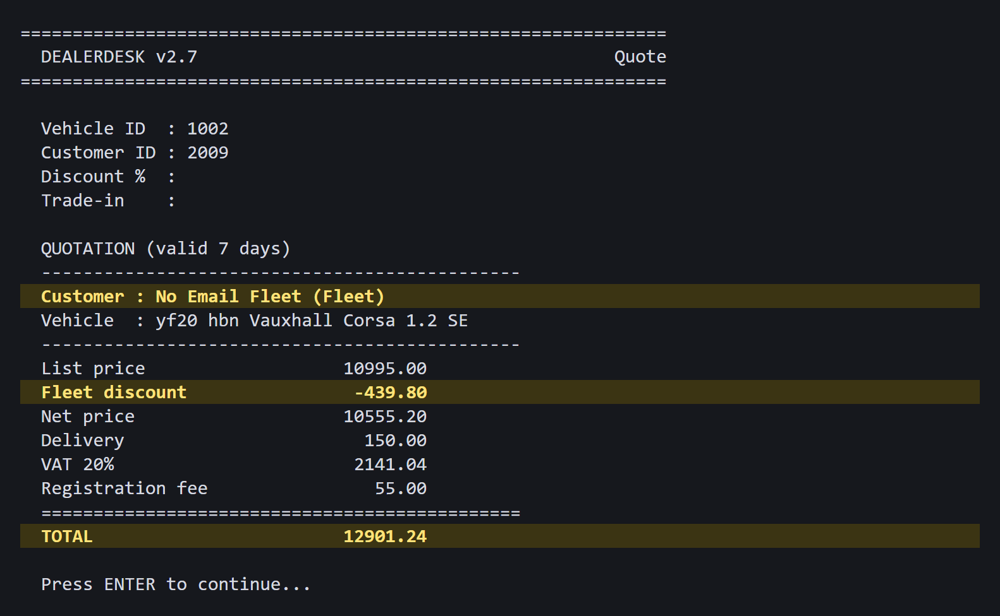

**This proves** the fix for BUG-002, without which this customer would lose 4% after every restart. The fix applies to all customers, so a trade customer with a blank field also keeps their discount. That is the one place a non-fleet total changes, and [fleet-discount.md](../fleet-discount.md) explains why it was accepted.

**Tested by:** `Fleet customer with no email stays Fleet`, `Fleet customer with no email buys after a restart`, `Blank details are kept by a later save`, `Trade customer with no email stays Trade`.

## UC-10: Roll back to v2.6 and return

**Who:** whoever runs a release. **Starts with:** v2.7 has written fleet data, and something forces a return to v2.6. [RELEASE.txt](../RELEASE.txt) puts the old binary back on the same data files.

This use case is not a spec scenario, because it needs two versions of the app. It was run for real here, using the v2.6 binary.

```text
GIVEN v2.7 has saved a fleet customer and a fleet invoice
WHEN  the old v2.6 binary runs on the same data files, and then v2.7 returns
THEN  every amount stays correct and the fleet customer is still type F
```

```text
  v2.7 running           v2.6 running                        v2.7 running again
  ----------------->     ----------------------------->      ----------------->
  writes type F          shows Retail, full price            shows Fleet again
  writes 12 fields       one discounts line, same total      fleet line is back
                               |
                               +-- if it saves invoices:  twelfth field is lost
                               +-- if it saves customers: a blank email is damaged
```

**1. v2.6 has no fleet discount.** It treats the customer as Retail, so staff would have to apply the discount by hand until v2.7 returns.

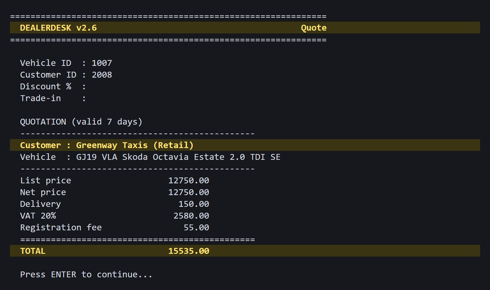

**2. v2.6 reads a fleet invoice correctly.** The discount shows on the combined line, and the total is the same.

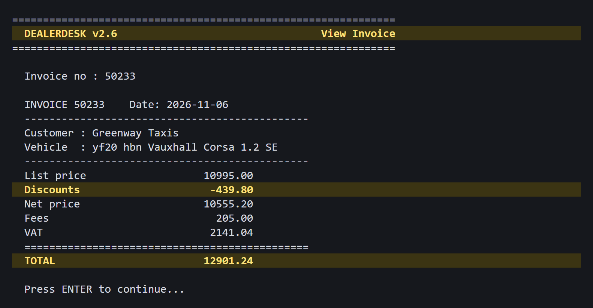

**3. The F survives a save by v2.6.** Here v2.6 adds a customer, which makes it rewrite `customers.dat`, and Greenway Taxis is still type F. The first two lines show what v2.7 wrote.

```console
$ grep '^2008' data/customers.dat
2008|Greenway Taxis|01632 960702|fleet@greenwaytaxis.example|F
$ grep '^50233' data/invoices.dat
50233|2026-11-06|1002|2008|10995.00|439.80|10555.20|2141.04|205.00|0.00|12901.24|439.80
$ grep -E '^(2008|2009)' data/customers.dat
2008|Greenway Taxis|01632 960702|fleet@greenwaytaxis.example|F
2009|Rollback Customer|01632 960127|rollback@example.com|R
```

**4. Back on v2.7, everything returns.**

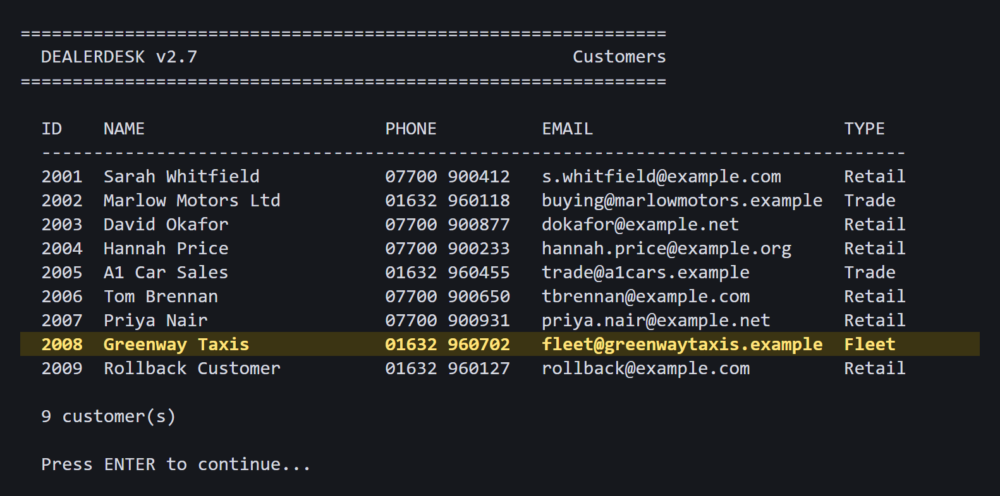

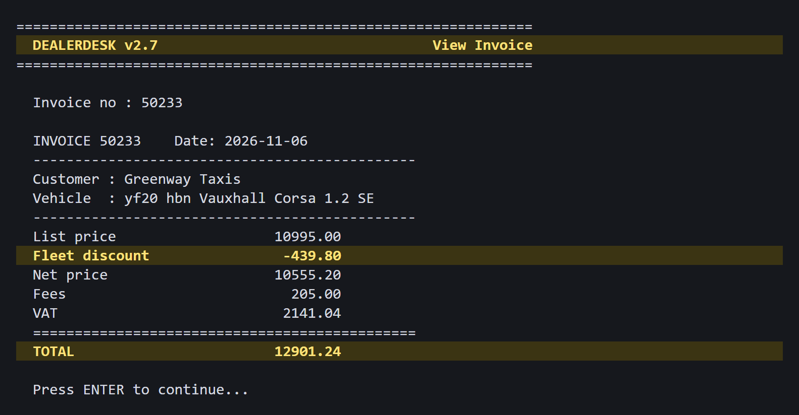

**What a rollback costs.** There are two real costs, and both were confirmed by running v2.6.

*If v2.6 saves invoices*, it drops the twelfth field it does not know about. Back on v2.7 that invoice loses its separate fleet line. The money is unaffected.

```console
$ grep '^50233' data/invoices.dat
50233|2026-11-06|1002|2008|10995.00|439.80|10555.20|2141.04|205.00|0.00|12901.24
```

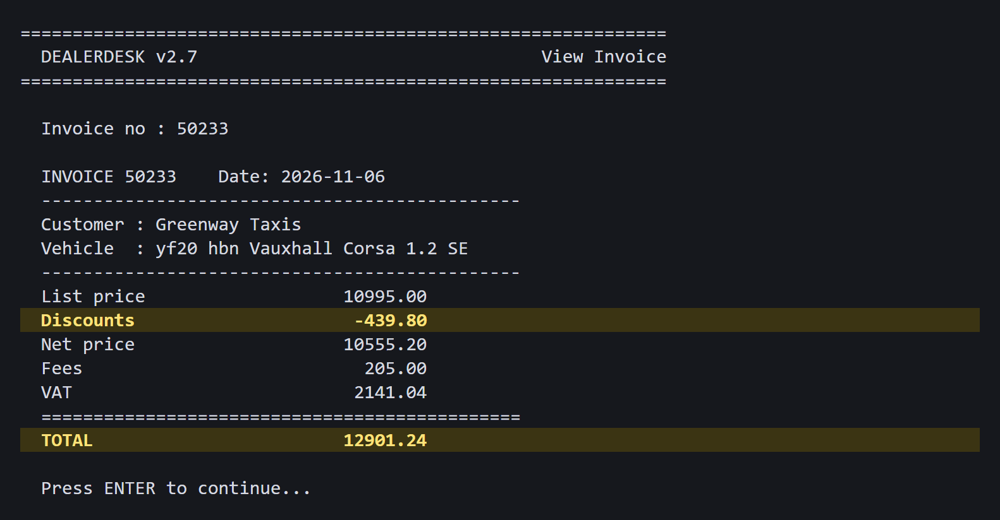

*If v2.6 saves customers*, BUG-002 comes back with it. A customer with a blank email is damaged for good, and v2.7 cannot repair the record. [fleet-discount.md](../fleet-discount.md) gives the command that finds these rows after a rollback.

```console
$ grep '^2009' data/customers.dat
2009|No Email Fleet|01632 960123||F
$ grep '^2009' data/customers.dat
2009|No Email Fleet|01632 960123|F|R
```

**This proves** that a rollback is safe for the money and shows exactly what it costs, so the decision can be made with open eyes.

## The tests behind these use cases

The use cases show one run. These show why the behaviour stays that way.

**All the tests pass on v2.7.** There are unit tests for pricing, six recorded sessions, and 219 Given/When/Then scenarios. Every one of the 220 scenarios in the specs has a test.

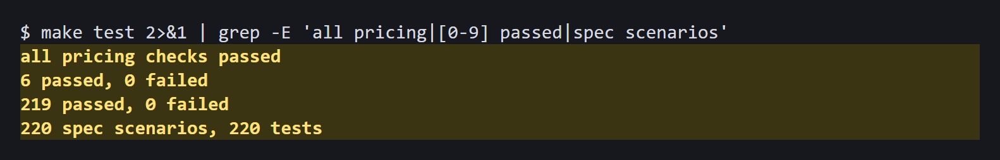

**The tests catch a wrong rate.** A test only counts if it can fail, so this run changed the rate from 4% to 5% in a throwaway copy of the code and ran the same tests.

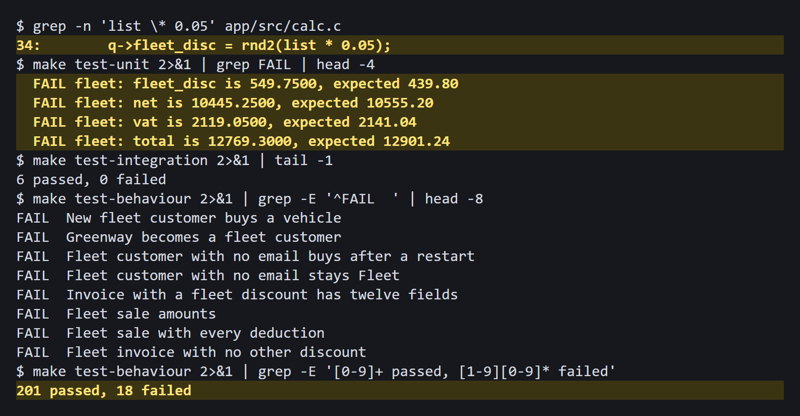

The unit tests name the wrong amounts, and 18 behaviour scenarios fail. The six recorded sessions still pass, and that is correct: they replay sessions with no fleet customer, so the fleet rate cannot touch them. That is the same reason they can prove non-fleet customers are unchanged.
